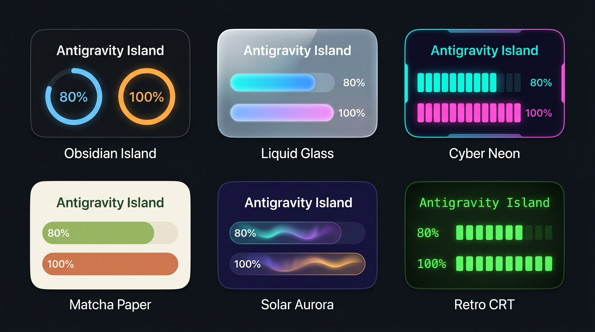
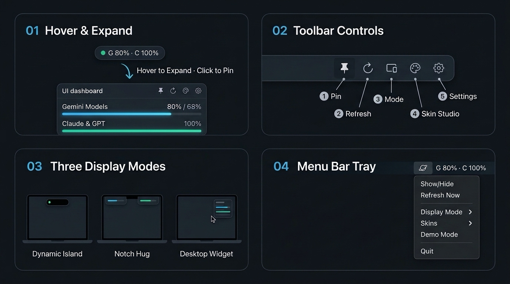
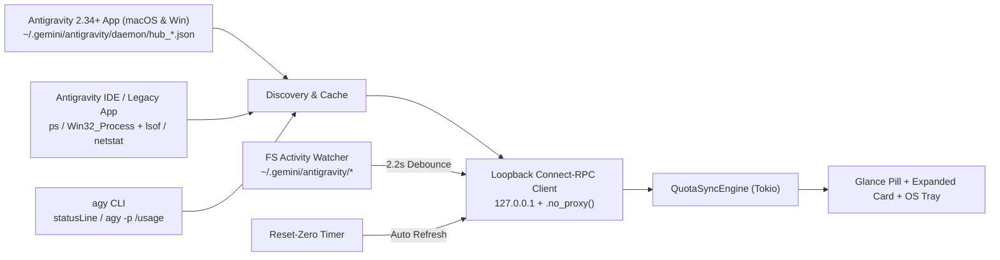

# Antigravity Island

<p align="center">
  <strong>English</strong> | <a href="README.zh-CN.md">简体中文</a>
</p>

<p align="center">
  <strong>A lightweight, pure-Rust Dynamic Island &amp; desktop quota widget for Google Antigravity on macOS &amp; Windows — engineered for instant at-a-glance readability, silent local loopback sync, and hot-reloadable custom skins.</strong>
</p>

<p align="center">
  
  
  
  
</p>

<p align="center">
  
</p>

---

## One-Click Install & Deploy

### macOS (Apple Silicon / Intel)

Automatically downloads the latest prebuilt binary from GitHub Releases (no Rust toolchain required; falls back to `cargo` source build if unavailable), installs the CLI + `Antigravity Island.app` (`LSUIElement = true`, zero Dock clutter), and launches immediately:

```bash
# Install and launch immediately
curl -fsSL https://raw.githubusercontent.com/JJacksonchen/antigravity-island/main/scripts/install.sh | bash

# Install + enable login autostart (macOS LaunchAgent)
curl -fsSL https://raw.githubusercontent.com/JJacksonchen/antigravity-island/main/scripts/install.sh | bash -s -- --autostart

# Uninstall (add --purge-config to also remove ~/.config/antigravity-island)
curl -fsSL https://raw.githubusercontent.com/JJacksonchen/antigravity-island/main/scripts/uninstall.sh | bash
```

### Windows 10 / 11 (PowerShell)

Automatically downloads the prebuilt `antigravity-island-windows-x86_64.zip` (no Rust toolchain required, or pass `-FromSource` to compile locally), installs into `%LOCALAPPDATA%\AntigravityIsland`, adds it to User `PATH`, creates a Start Menu shortcut, and launches cleanly in the background with zero console window flicker:

```powershell
# Install and launch immediately
irm https://raw.githubusercontent.com/JJacksonchen/antigravity-island/main/scripts/install.ps1 | iex

# Install + enable login autostart (HKCU\...\Run)
& ([scriptblock]::Create((irm https://raw.githubusercontent.com/JJacksonchen/antigravity-island/main/scripts/install.ps1))) -Autostart

# Uninstall (add -PurgeConfig to also remove config directory)
irm https://raw.githubusercontent.com/JJacksonchen/antigravity-island/main/scripts/uninstall.ps1 | iex
```

> **Tip:** Want to preview the UI before opening Antigravity? Run `antigravity-island --demo` to explore live animated quota telemetry and all 6 built-in skins immediately.

---

## At-a-Glance Dual-Platform Design

Checking **Google Antigravity** quota normally requires switching windows, opening **Settings → Models**, or running `/usage`. **Antigravity Island** delivers a **zero-click, single-glance** HUD on both macOS and Windows:

- **Dual-Row Glance Pill (Default)**: Read every model pool's status without hovering — a **concentric dual-ring** (`outer = 5h`, `inner = weekly`) paired with **Row 1** (`5h` badge + bold remaining `%` + dedicated `⏱` 5h refresh countdown pill) and **Row 2** (`7d` remaining `%` + mini weekly progress bar), anchored by a bottom **ambient health rail** (emerald/sky → amber → pulsing coral). Fixed tabular widths and silent steady-state sync ensure **zero jitter or movement** on background refreshes.
- **Universal Free Drag & 1-Click Hide (macOS & Windows)**: Drag the collapsed pill or expanded card header freely to any monitor position in both `Island` and `Widget` modes (horizontal center is remembered so expand/collapse stays symmetrical; double-click the header or click **Top Center** to reset). Hide instantly via **right-click on the pill**, the **eye-off icon**, or the tray menu.
- **Smart macOS Menu Bar Deduplication**: Floats cleanly **below** the macOS menu bar by default (never overlapping menu bar items; explicit `Notch Hug` mode remains available for camera-notch MacBooks). While the Island is visible, the menu bar shows only a crisp monochrome **Antigravity "A" arch template icon**; the moment you hide the Island, live quota text (`G 61%/63% · C 100%`) automatically appears in the menu bar (or toggle **Menu Bar Text** in Settings to keep it always on).
- **Native Windows Tray Companion**: Borderless top floating Island (`WS_EX_TOOLWINDOW` + `skip_taskbar`, zero taskbar/Alt+Tab clutter, zero 1px white border, zero console flash) paired with a **live 32×32 colored circular quota ring tray icon** featuring the Antigravity "A" arch emblem — **left-click** to toggle Show/Hide, **right-click** for full controls, and **hover** for a multi-line quota & reset tooltip.
- **Instant Compact Mode**: Switch anytime between `Glance` (dual-row 5h + weekly + countdown) and `Compact` (minimal pill) from Settings or the tray menu.

<p align="center">
  
</p>

---

## 6 Built-in Skins

<p align="center">
  
</p>

| Skin ID | Name | Gauge Style | Aesthetic & Highlights |
| :--- | :--- | :--- | :--- |
| `obsidian` | **Obsidian Island** | `ring` | Signature matte-black Apple Dynamic Island with crisp SVG rings and subtle breathing glow |
| `frosted-glass` | **Liquid Glass** | `bar` | Translucent frosted glass with specular edge highlights and gradient progress bars |
| `cyber-neon` | **Cyber Neon** | `segments` | Cyberpunk HUD with glowing cyan/magenta 12-segment laser bars |
| `matcha-paper` | **Matcha Paper** | `bar` | Warm daytime Japanese stationery palette with eye-friendly matcha green and terracotta accents |
| `solar-aurora` | **Solar Aurora** | `wave` | Aurora gradient backdrop paired with animated SVG liquid-wave energy gauges |
| `retro-pixel` | **Retro CRT** | `segments` | Phosphor-green monospace terminal aesthetic with retro hardware scanlines |

---

## Operation Guide

<p align="center">
  
</p>

| Operation / Control | Action / Behavior |
| :--- | :--- |
| **Hover Pill** | Smoothly expands the full quota dashboard after 180ms in `Island` / `Notch Hug` mode; auto-collapses 260ms after mouse leaves |
| **Drag Pill or Header** | Drag anywhere on screen (multi-monitor supported) in both `Island` and `Widget` modes on macOS & Windows; double-click the header to reset to Top Center |
| **Right-Click Pill / `👁` Hide** | Instantly hides the floating Island; restore via Windows tray left-click or the macOS/Windows tray menu |
| **`📌` Pin** | Locks the expanded dashboard open so leaving hover does not collapse it |
| **`↻` Refresh** | Triggers an immediate local quota sync (calm accent flash, zero spin jitter) |
| **`◫` Mode** | Toggles between **Dynamic Island** (hover-expand · draggable), **Notch Hug** (macOS camera notch wings), and **Desktop Widget** (click-expand · draggable) |
| **`🎨` Skin Studio** | Live-switch 6 built-in skins or customize gauge renderer, accent colors, corner radius, opacity, and glow — save directly to hot-reloaded `.toml` |
| **`⚙` Settings** | Configure display mode, pill density (`Glance` / `Compact`), reset position, macOS menu bar text toggle, sync rate (`5s–60s`), language (`Auto` / `中文` / `EN`), and low-quota alerts |
| **Tray / Menu Bar** | macOS automatically shows live quota text when hidden and clean icon-only when visible; Windows tray ring toggles visibility on left-click and opens menu on right-click |

---

## Skin Studio & Real-Time Sync Architecture

<p align="center">
  
</p>

### Local Sync Pipeline



1. **Zero-Config Cross-Platform Discovery**: Reads Antigravity 2.34+ `~/.gemini/antigravity/daemon/hub_*.json` (`%USERPROFILE%\.gemini\antigravity\daemon\hub_*.json` on Windows), verifies live PID ownership, and connects directly over localhost. Seamlessly falls back to legacy `--csrf_token` process discovery (`ps` + `lsof` on macOS/Linux; `Win32_Process` + `netstat` with `CREATE_NO_WINDOW` on Windows).
2. **Multi-Stage Graceful Fallback**: `RetrieveUserQuotaSummary` (complete 5h + Weekly pool breakdown) + `GetUserStatus` (Account Tier & AI Credits) → `GetUserStatus` model quotas → `GetCommandModelConfigs` → CLI `statusLine` / `agy -p /usage`.
3. **Proxy-Proof Loopback RPC**: Built with `.no_proxy()` so system proxies (Clash / Surge / corporate VPNs) never intercept `127.0.0.1` traffic.
4. **Lightweight Native Performance**: Single pure-Rust release binary (~**7.3 MB**), native OS WebView (`WKWebView` / `WebView2`), ~**63–75 MB RSS**, and **0.0% idle CPU**.

---

## CLI Usage & `agy statusLine` Integration

```text
antigravity-island [OPTIONS] [COMMAND]

Options:
  --demo                 Launch GUI with simulated live quota stream (no Antigravity needed)
  --skin <ID>            Start with a specific skin ID (e.g., cyber-neon)
  --mode <MODE>          Override display mode: island | notch-hug | widget
  --probe                Fetch live quota once, print to stdout, and exit
  --json                 Emit raw JSON snapshot (used with --probe)
  --list-skins           List all built-in and custom skins, then exit

Commands:
  ingest-statusline      Read Antigravity CLI statusLine JSON from stdin and push to the Island
```

### Wire into `agy` CLI `statusLine`

Add to `~/.gemini/antigravity-cli/settings.json`:

```json
{
  "statusLine": {
    "type": "command",
    "command": "antigravity-island ingest-statusline"
  }
}
```

---

## Authoring Custom Skins

Custom skin files live in `~/.config/antigravity-island/skins/*.toml` (`%USERPROFILE%\.config\antigravity-island\skins\*.toml` on Windows) and hot-reload in milliseconds upon saving — no restart needed. See [`skins/cyberpunk-neon-sample.toml`](skins/cyberpunk-neon-sample.toml) for a complete template.

---

## Build from Source & Testing

```bash
git clone https://github.com/JJacksonchen/antigravity-island.git
cd antigravity-island

# Format, lint & run all 19 unit/integration tests
cargo fmt --check
cargo clippy --all-targets -- -D warnings
cargo test

# macOS: build and package .app bundle locally
./scripts/bundle-macos.sh
open "Antigravity Island.app"

# Windows (PowerShell): build release binary locally
cargo build --release
.\target\release\antigravity-island.exe
```

### Privacy & Security

- Every local RPC call strictly verifies the loopback host (`127.0.0.1`) and never transmits CSRF tokens to external endpoints.
- Never reads or stores Google OAuth refresh tokens or cloud credentials. Zero telemetry.

---

## License

[MIT](LICENSE)
