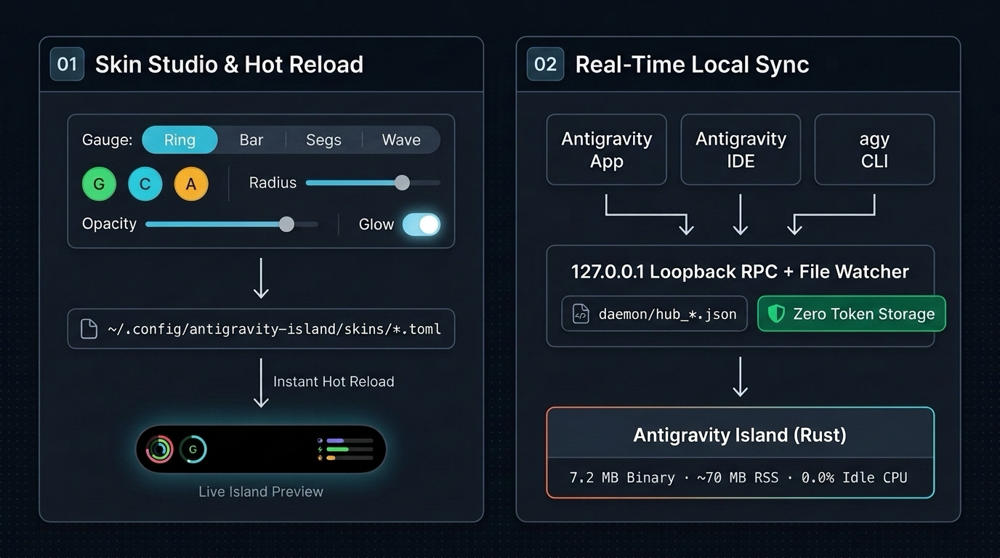
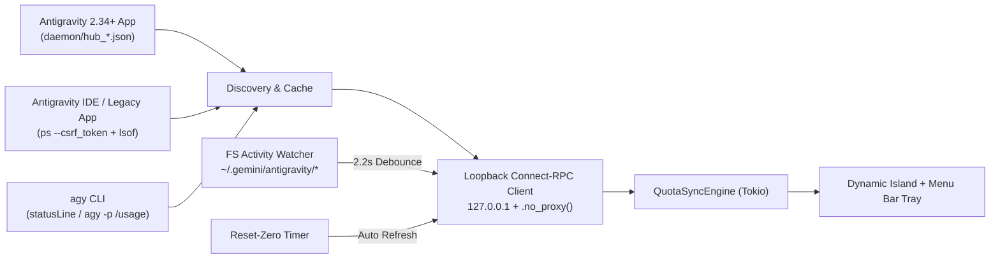

# Antigravity Island

<p align="center">
  <strong>A lightweight, pure-Rust Dynamic Island &amp; desktop quota widget for Google Antigravity — featuring instant local loopback sync, 3 floating morphologies, and hot-reloadable custom skins.</strong><br/>
  <strong>纯 Rust 编写的高性能 Google Antigravity 灵动岛 / 桌面悬浮额度监控插件，支持毫秒级本地实时同步、三种桌面形态与热重载自定义皮肤。</strong>
</p>

<p align="center">
  
  
  
  
</p>

<p align="center">
  
</p>

---

## One-Click Install & Deploy / 一键部署安装

### macOS（预编译极速安装 / 自动回退源码构建）

打开终端运行以下命令即可全自动安装 CLI 二进制、`Antigravity Island.app`（`LSUIElement = true`，不占用 Dock 栏图标），并初始化皮肤目录后自动启动：

```bash
curl -fsSL https://raw.githubusercontent.com/JJacksonchen/antigravity-island/main/scripts/install.sh | bash
```

**常用部署变体 / Options：**

```bash
# 一键安装 + 配置 macOS 开机自启动 (LaunchAgent)
curl -fsSL https://raw.githubusercontent.com/JJacksonchen/antigravity-island/main/scripts/install.sh | bash -s -- --autostart

# 强制从源码本地编译安装（需已安装 Rust toolchain）
curl -fsSL https://raw.githubusercontent.com/JJacksonchen/antigravity-island/main/scripts/install.sh | bash -s -- --from-source

# 仅安装、暂不自动打开应用
curl -fsSL https://raw.githubusercontent.com/JJacksonchen/antigravity-island/main/scripts/install.sh | bash -s -- --no-launch

# 一键卸载（追加 --purge-config 可同时清理 ~/.config/antigravity-island）
curl -fsSL https://raw.githubusercontent.com/JJacksonchen/antigravity-island/main/scripts/uninstall.sh | bash
```

> **Tip**: 尚未安装 Antigravity 或想先体验全部皮肤与动画？安装后直接运行 `antigravity-island --demo` 即可进入模拟额度流预览模式。

---

## Why Antigravity Island? / 解决什么痛点？

在 **Google Antigravity** 中查看模型剩余配额与重置倒计时，通常需要切回主窗口、打开 **Settings → Models** 面板或运行 `/usage`。**Antigravity Island** 将所有模型池额度直接悬浮于屏幕顶部「灵动岛」与菜单栏中：

- **Zero-click glanceability / 零点击抬眼可见**：顶部折叠胶囊实时展示核心模型池剩余百分比（如 `G 80% · C 100%`），鼠标轻停即可丝滑展开完整面板，点击图钉按钮可常驻锁定。
- **Accurate, timely local sync / 精准实时同步**：直连本地 Antigravity 语言服务（兼容 Antigravity 2.34+ `daemon/hub_*.json` 与传统 `--csrf_token` Connect-RPC），并被动监听 `~/.gemini/antigravity/` 会话活动与配额窗口重置时刻，在对话完成或倒计时归零时自动触发即时刷新。
- **Hot-reloadable Skin Studio / 内置皮肤工坊 + 热重载**：自带 6 套精选皮肤与 4 种仪表渲染器（`ring` 圆环 / `bar` 液态条 / `segments` 分段格 / `wave` 动态波浪），支持面板内实时调色保存，或直接编辑 `~/.config/antigravity-island/skins/*.toml` 与 `custom_css` 即刻生效。
- **Pure Rust performance / 纯 Rust 极简轻量**：无 Electron / Node 运行时负担；Release 二进制仅 **7.2 MB**，包含系统原生 WKWebView 常驻内存约 **67–77 MB RSS**，空闲时 **0.0% CPU**。

---

## 6 Built-in Skins / 内置皮肤展示

<p align="center">
  
</p>

| Skin ID | Name | Gauge Style | Aesthetic & Highlights |
| :--- | :--- | :--- | :--- |
| `obsidian` | **Obsidian Island** | `ring` | 经典哑光黑 Apple 灵动岛风格，清晰 SVG 圆环与低占用呼吸灯 |
| `frosted-glass` | **Liquid Glass** | `bar` | macOS 毛玻璃半透明磨砂质感，带高光边缘与渐变进度条 |
| `cyber-neon` | **Cyber Neon** | `segments` | 赛博霓虹 HUD，青/品红 12 格发光激光分段条 |
| `matcha-paper` | **Matcha Paper** | `bar` | 日间暖调和纸手账风格，抹茶绿与赤陶橙护眼配色 |
| `solar-aurora` | **Solar Aurora** | `wave` | 极光渐变背景搭配动态 SVG 波浪液态能量条 |
| `retro-pixel` | **Retro CRT** | `segments` | 复古荧光绿等宽终端扫描线风格，极客硬件仪表感 |

---

## Operation Guide / 详细操作示意图

<p align="center">
  
</p>

### 1. 交互与工具栏说明 / Interactions & Toolbar

| Operation / Button | Action / Behavior |
| :--- | :--- |
| **Hover Pill / 悬停胶囊** | 在 `Island` / `Notch Hug` 模式下悬停 85ms 丝滑展开完整面板，移出 260ms 自动收起 |
| **Click Pill / 单击胶囊** | 在任何模式下立即展开面板（`Desktop Widget` 模式下支持单击展开、拖拽移动位置） |
| **`📌` Pin / 图钉** | 锁定保持展开状态，悬停移出不收起；再次点击或点 `Collapse` 收起 |
| **`↻` Refresh / 刷新** | 立即向本地 Antigravity 后台发起一次最新配额查询 |
| **`◫` Mode / 形态切换** | 一键在 **Dynamic Island**（顶部居中）、**Notch Hug**（MacBook 刘海双翼融合）与 **Desktop Widget**（桌面自由拖拽悬浮窗）之间切换 |
| **`🎨` Skin Studio / 皮肤工坊** | 打开内置皮肤切换网格与实时调色器（仪表样式、强调色、圆角、透明度、呼吸光晕），一键保存为 `.toml` |
| **`⚙` Settings / 偏好设置** | 切换展示形态、同步刷新间隔（`5s / 15s / 30s / 60s`）、界面语言（`Auto / 中文 / EN`）、低额度弹窗通知与演示模式 |
| **Menu Bar Tray / 顶部菜单栏** | 状态栏实时显示 `G 80% · C 100%`，右键/点击可隐藏岛体、锁定展开、切换皮肤、打开皮肤目录或退出 |

---

## Skin Studio & Real-Time Sync Architecture / 皮肤热重载与实时同步原理

<p align="center">
  
</p>

### Local Sync Pipeline / 本地同步链路



1. **优先直连本地 RPC**：读取 Antigravity 2.34+ 写入的 `~/.gemini/antigravity/daemon/hub_*.json`（校验 PID 存活后直接获取端口与 CSRF Token，无需 `lsof` 子进程），或兼容旧版 `--csrf_token` 进程发现。
2. **三段式优雅回退**：`RetrieveUserQuotaSummary`（获取完整 5h / Weekly 分组池）+ `GetUserStatus`（补充账号 Tier / AI Credits）→ `GetUserStatus` 模型配额 → `GetCommandModelConfigs` → CLI `statusLine` / `agy -p /usage`。
3. **绕过系统代理**：内置 `.no_proxy()`，即使本机开启了 HTTP/SOCKS 代理（如 Clash/Surge `127.0.0.1:7897`），本地回环 RPC 也不会被误拦截。

---

## CLI Usage & `agy statusLine` Integration / 命令行用法

```text
antigravity-island [OPTIONS] [COMMAND]

Options:
  --demo                 以模拟实时额度流启动 GUI（无需运行 Antigravity）
  --skin <ID>            指定启动皮肤 ID（如 cyber-neon）
  --mode <MODE>          指定展示形态：island | notch-hug | widget
  --probe                执行一次实时额度探测并输出到终端后退出
  --json                 配合 --probe 输出完整 JSON 快照
  --list-skins           列出所有内置及自定义皮肤

Commands:
  ingest-statusline      从 stdin 读取 Antigravity CLI statusLine JSON 并推送给灵动岛
```

### Example: Terminal Quick Probe / 终端快速查额度

```bash
antigravity-island --probe
```

### Example: Wire into `agy` CLI `statusLine`

如果你在终端使用 Antigravity CLI (`agy`)，可在 `~/.gemini/antigravity-cli/settings.json` 中添加：

```json
{
  "statusLine": {
    "type": "command",
    "command": "~/.local/bin/antigravity-island ingest-statusline"
  }
}
```

---

## Authoring Custom Skins / 手写自定义皮肤

所有自定义皮肤存放在 `~/.config/antigravity-island/skins/*.toml`。文件保存后由 `notify` 文件监听器毫秒级热重载，无需重启应用；若自定义皮肤的 `id` 与内置皮肤一致，则会直接覆盖该内置皮肤。参考模板：[`skins/cyberpunk-neon-sample.toml`](skins/cyberpunk-neon-sample.toml)。

```toml
id = "cyberpunk-custom"
name = "Cyberpunk Custom"
author = "You"
description = "High-contrast synthwave HUD"

[palette]
bg = "rgba(8, 7, 20, 0.94)"
bg_expanded = "rgba(10, 8, 24, 0.96)"
surface = "rgba(0, 245, 212, 0.06)"
border = "rgba(0, 245, 212, 0.36)"
text_primary = "#ecfeff"
text_secondary = "#a5f3fc"
text_muted = "#67e8f9"
accent_gemini = "#00f5d4"
accent_claude = "#ff4ecd"
accent_argon = "#a78bfa"
ok_color = "#00f5d4"
warn_color = "#fde047"
danger_color = "#ff2a6d"
track_bg = "rgba(0, 245, 212, 0.14)"

[geometry]
pill_radius_px = 14
card_radius_px = 18
border_width_px = 1.25
blur_px = 18
scale = 1.0

[style]
gauge = "segments" # "ring" | "bar" | "segments" | "wave"
glow = true
glow_intensity = 0.85
animations = true
noise_overlay = false

custom_css = """
.island-shell {
  background-image: radial-gradient(circle at 15% 0%, rgba(255, 78, 205, 0.14), transparent 45%);
}
"""
```

---

## Build from Source & Testing / 源码构建与自测

```bash
git clone https://github.com/JJacksonchen/antigravity-island.git
cd antigravity-island

# Format, lint & run all 18 unit/integration tests
cargo fmt --check
cargo clippy --all-targets -- -D warnings
cargo test

# Package macOS .app bundle locally
./scripts/bundle-macos.sh
open "Antigravity Island.app"
```

### Privacy & Security / 隐私与安全声明

- 所有本地请求严格校验目标主机必须为 `127.0.0.1`，绝不向任何外部域名传输本机 CSRF Token。
- 不读取、不存储 Google OAuth Refresh Token 或任何云端凭证，零遥测上报。

---

## License

[MIT](LICENSE)
