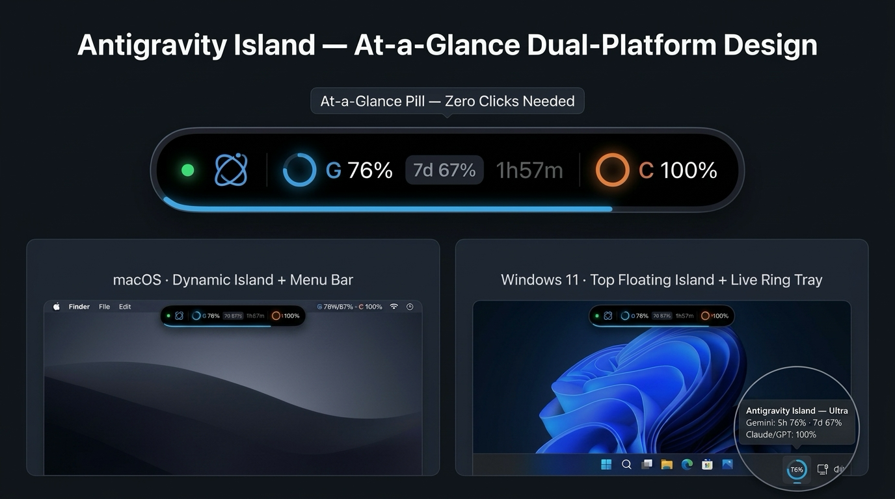
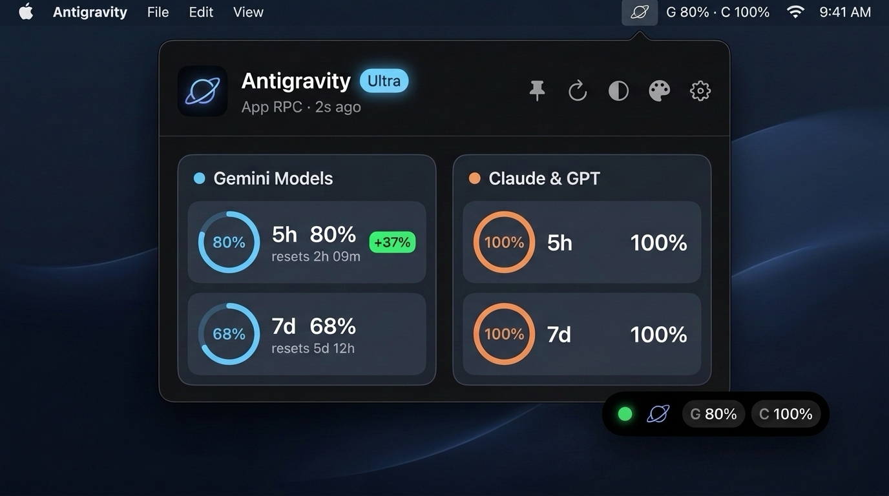
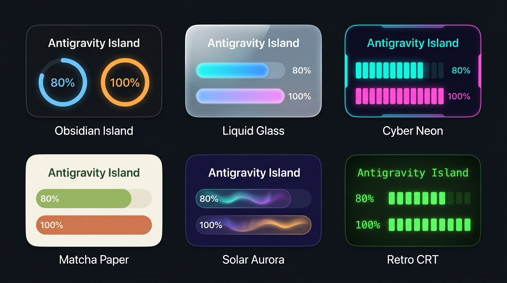
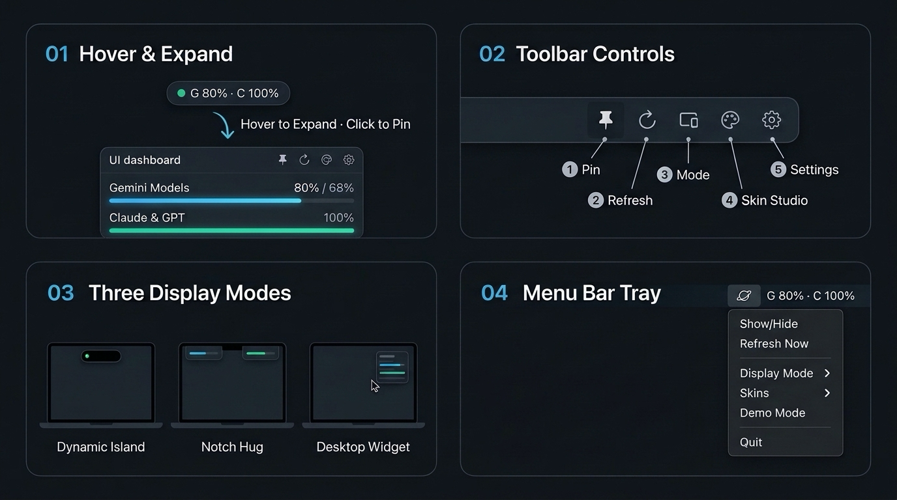
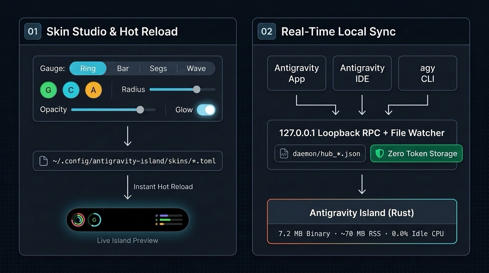
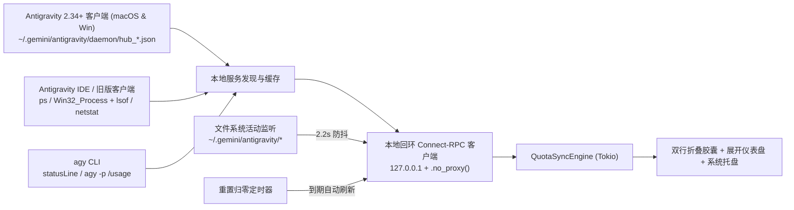

# Antigravity Island

<p align="center">
  <a href="README.md">English</a> | <strong>简体中文</strong>
</p>

<p align="center">
  <strong>纯 Rust 编写的高性能 Google Antigravity 双端（macOS / Windows）灵动岛与桌面额度悬浮插件：抬眼即知剩余额度，静默本地实时同步，支持热重载自定义皮肤。</strong>
</p>

<p align="center">
  
  
  
  
</p>

<p align="center">
  
</p>

---

## 双端一键部署安装

### macOS（Apple Silicon / Intel）

自动下载 GitHub Releases 最新预编译二进制（无需安装 Rust 环境；若下载不可用则自动回退 `cargo` 源码编译），安装 CLI 与 `Antigravity Island.app`（`LSUIElement = true`，不占 Dock 栏图标）并立即启动：

```bash
# 一键安装并立即启动
curl -fsSL https://raw.githubusercontent.com/JJacksonchen/antigravity-island/main/scripts/install.sh | bash

# 一键安装 + 配置 macOS 开机自启动（LaunchAgent）
curl -fsSL https://raw.githubusercontent.com/JJacksonchen/antigravity-island/main/scripts/install.sh | bash -s -- --autostart

# 一键卸载（追加 --purge-config 同时清理配置目录）
curl -fsSL https://raw.githubusercontent.com/JJacksonchen/antigravity-island/main/scripts/uninstall.sh | bash
```

### Windows 10 / 11（PowerShell）

自动下载预编译 `antigravity-island-windows-x86_64.zip`（无需 Rust 环境，或传 `-FromSource` 本地编译），安装至 `%LOCALAPPDATA%\AntigravityIsland`、自动加入用户 `PATH`、创建开始菜单快捷方式并无黑框后台启动：

```powershell
# 一键安装并立即启动
irm https://raw.githubusercontent.com/JJacksonchen/antigravity-island/main/scripts/install.ps1 | iex

# 一键安装 + 配置 Windows 开机自启动（HKCU\...\Run）
& ([scriptblock]::Create((irm https://raw.githubusercontent.com/JJacksonchen/antigravity-island/main/scripts/install.ps1))) -Autostart

# 一键卸载（追加 -PurgeConfig 同时清理配置目录）
irm https://raw.githubusercontent.com/JJacksonchen/antigravity-island/main/scripts/uninstall.ps1 | iex
```

> **提示**：尚未打开 Antigravity 时，可运行 `antigravity-island --demo` 立即体验实时模拟额度流与全部 6 套皮肤效果。

---

## 双端「看一眼就知道额度」设计

传统查看 **Google Antigravity** 配额需要切换窗口、点开 **Settings → Models** 或输入 `/usage`。**Antigravity Island** 在 macOS 和 Windows 上均坚持 **零点击、抬眼即知** 的信息层级：

- **双行一眼看清折叠胶囊（Glance Pill，默认）**：无需悬停即可直接读取每个模型池的 **同心双环（外环 5h 额度 + 内环周额度）** —— 第一行清晰展示 **`5h` 徽标 + 粗体剩余百分比 + 独立 `⏱` 5h 刷新倒计时胶囊**，第二行独立展示 **`周` 剩余百分比 + 迷你周进度条**，底部配有全局 **环境健康度光轨**（充裕绿/天蓝 → 预警琥珀 → 告急脉冲红）。锁定等宽数值布局并采用稳态静默刷新，**后台刷新全程纹丝不动、零抖动**。
- **双端自由拖拽 + 一键隐藏**：macOS 与 Windows 无论在 `Island` 还是 `Widget` 形态下，均支持 **直接按住折叠胶囊或展开卡片标题栏自由拖拽** 至任意屏幕位置（支持多屏，自动记忆水平中心坐标，展开/收起对称平滑；双击标题栏或点「居中置顶」一键复位）。支持 **右键胶囊 / 点击隐藏眼睛图标 / 托盘菜单** 一键隐藏与恢复。
- **macOS 零遮挡、零重复状态栏联动**：默认居中悬浮于 macOS 菜单栏正下方，绝不遮挡菜单栏（MacBook 刘海屏仍可手动切换 `Notch Hug` 刘海融合模式）。灵动岛可见时，顶部菜单栏仅显示清爽的 **反重力「A」字弧形单色模板 Logo**，避免数值重复；当你隐藏灵动岛后，状态栏自动接管显示实时额度文字（`G 61%/63% · C 100%`），亦可在设置中开启「状态栏文字」常驻。
- **Windows 原生托盘双保险**：顶部无边框透明灵动岛（`WS_EX_TOOLWINDOW` + `skip_taskbar`，不占任务栏与 `Alt+Tab`、无 1px 白边、无黑框闪烁）+ **32×32 动态彩色进度环托盘图标**（圆环中央嵌入反重力「A」字徽标）—— **左键单击托盘图标直接切换显示/隐藏**，右键打开完整菜单，悬停查看多行配额与重置倒计时明细。
- **极简模式随时切换**：在偏好设置或托盘菜单中可随时切换 `Glance（双行一眼看清）` 与 `Compact（极简胶囊）`。

<p align="center">
  
</p>

---

## 6 套内置皮肤与仪表展示

<p align="center">
  
</p>

| 皮肤 ID | 皮肤名称 | 仪表样式 | 风格亮点 |
| :--- | :--- | :--- | :--- |
| `obsidian` | **Obsidian Island** | `ring` | 经典哑光黑 Apple 灵动岛风格，清晰 SVG 圆环与低占用呼吸灯 |
| `frosted-glass` | **Liquid Glass** | `bar` | 毛玻璃半透明磨砂质感，带高光边缘与渐变进度条 |
| `cyber-neon` | **Cyber Neon** | `segments` | 赛博霓虹 HUD，青/品红 12 格发光激光分段条 |
| `matcha-paper` | **Matcha Paper** | `bar` | 日间暖调和纸手账风格，抹茶绿与赤陶橙护眼配色 |
| `solar-aurora` | **Solar Aurora** | `wave` | 极光渐变背景搭配动态 SVG 波浪液态能量条 |
| `retro-pixel` | **Retro CRT** | `segments` | 复古荧光绿等宽终端扫描线风格，极客硬件仪表感 |

---

## 详细操作示意图

<p align="center">
  
</p>

| 操作 / 按钮 | 功能说明 |
| :--- | :--- |
| **悬停胶囊** | `Island` / `Notch Hug` 模式下悬停 180ms 丝滑展开完整仪表盘，移出 260ms 自动收起 |
| **自由拖拽胶囊或标题栏** | macOS 与 Windows 的 `Island` / `Widget` 形态均支持按住胶囊或标题栏任意拖动并记忆位置，双击标题栏恢复顶部居中 |
| **右键胶囊 / `👁` 隐藏按钮** | 一键隐藏灵动岛；通过 Windows 左键托盘图标或 macOS / Windows 托盘菜单随时恢复显示 |
| **`📌` 图钉（Pin）** | 锁定保持展开状态，鼠标移出不收起；再次点击或点击「收起」折叠 |
| **`↻` 立即刷新** | 立即向本地 Antigravity 后台发起一次最新配额同步（静谧高亮提示，无旋转抖动） |
| **`◫` 形态切换** | 切换 **Dynamic Island**（悬停展开 · 可拖拽）、**Notch Hug**（macOS 刘海融合）与 **Desktop Widget**（点击展开 · 可拖拽） |
| **`🎨` 皮肤工坊** | 实时切换 6 套内置皮肤，或自定义进度样式、三组强调色、圆角、透明度与光晕，一键保存为 `.toml` 热重载生效 |
| **`⚙` 偏好设置** | 切换展示形态、胶囊密度（`Glance / Compact`）、居中置顶复位、macOS 状态栏文字开关、刷新频率（`5s–60s`）、界面语言（`Auto / 中文 / EN`）与低额度提醒 |
| **托盘 / 状态栏** | macOS 隐藏时自动接管显示实时额度，显示时自动切回极简反重力 Logo；Windows 彩色进度环左键显隐、右键菜单 |

---

## 皮肤热重载与实时同步架构

<p align="center">
  
</p>

### 双端本地同步链路



1. **双端零配置自动发现**：优先读取 Antigravity 2.34+ 写入的 `~/.gemini/antigravity/daemon/hub_*.json`（Windows 为 `%USERPROFILE%\.gemini\antigravity\daemon\hub_*.json`），校验进程 PID 存活后直连本地端口；同时兼容传统 `--csrf_token` 进程发现（macOS `ps` + `lsof`，Windows `Win32_Process` + `netstat`，全程 `CREATE_NO_WINDOW` 静默无黑框）。
2. **三段式优雅回退**：`RetrieveUserQuotaSummary`（获取完整 5h / 周额度分组池）+ `GetUserStatus`（补充订阅方案与 AI Credits）→ `GetUserStatus` 模型配额 → `GetCommandModelConfigs` → CLI `statusLine` / `agy -p /usage`。
3. **绕过系统代理**：回环客户端内置 `.no_proxy()`，即使开启 Clash / Surge / 企业代理也不会拦截 `127.0.0.1` 本地 RPC 请求。
4. **轻量高性能**：纯 Rust 单文件 Release 二进制约 **7.3 MB**，基于系统原生 WebView（macOS `WKWebView` / Windows `WebView2`），常驻内存约 **63–75 MB RSS**，空闲 **0.0% CPU**。

---

## 命令行用法与 `agy statusLine` 接入

```text
antigravity-island [OPTIONS] [COMMAND]

Options:
  --demo                 以模拟实时额度流启动 GUI（无需运行 Antigravity）
  --skin <ID>            指定启动皮肤 ID（如 cyber-neon）
  --mode <MODE>          指定展示形态：island | notch-hug | widget
  --probe                执行一次实时额度探测并输出到终端后退出
  --json                 配合 --probe 输出完整 JSON 快照
  --list-skins           列出所有内置及自定义皮肤并退出

Commands:
  ingest-statusline      从 stdin 读取 Antigravity CLI statusLine JSON 并推送给灵动岛
```

### 接入 `agy` CLI `statusLine`

在 `~/.gemini/antigravity-cli/settings.json` 中添加：

```json
{
  "statusLine": {
    "type": "command",
    "command": "antigravity-island ingest-statusline"
  }
}
```

---

## 手写自定义皮肤

自定义皮肤位于 `~/.config/antigravity-island/skins/*.toml`（Windows 位于 `%USERPROFILE%\.config\antigravity-island\skins\*.toml`），编辑保存后毫秒级热重载生效，无需重启。完整示例模板见 [`skins/cyberpunk-neon-sample.toml`](skins/cyberpunk-neon-sample.toml)。

---

## 源码构建与自测

```bash
git clone https://github.com/JJacksonchen/antigravity-island.git
cd antigravity-island

# 代码格式化、Clippy 静态检查与全部 19 项单元/集成测试
cargo fmt --check
cargo clippy --all-targets -- -D warnings
cargo test

# macOS：本地打包 .app 应用
./scripts/bundle-macos.sh
open "Antigravity Island.app"

# Windows (PowerShell)：本地源码构建 Release 二进制
cargo build --release
.\target\release\antigravity-island.exe
```

### 隐私与安全声明

- 所有本地请求严格校验目标主机必须为 `127.0.0.1`，绝不向任何外部域名传输本机 CSRF Token。
- 不读取、不存储 Google OAuth Refresh Token 或任何云端凭证，零遥测上报。

---

## 开源协议

[MIT](LICENSE)
